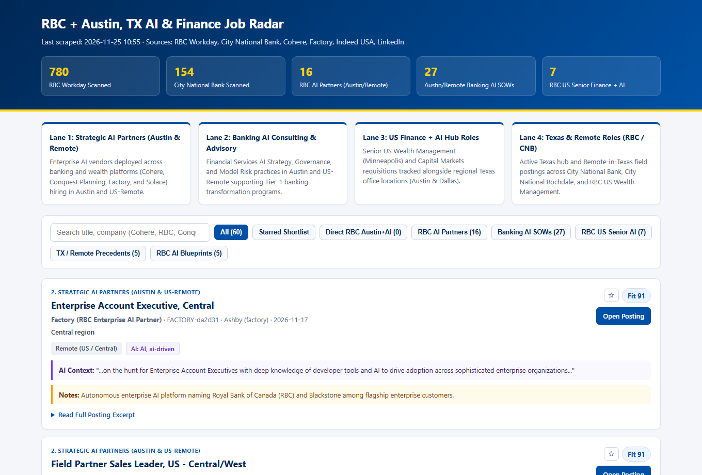

# RBC + Austin, TX AI & Finance Job Radar


-ffd200?style=flat-square&labelColor=002855)

A self-contained multi-portal job scraper and local interactive web dashboard tracking **AI, data, and financial services roles** across **RBC**, **City National Bank**, **enterprise AI partners**, and **Austin, TX / US-Remote** hiring channels.



---

## Quick Start

### Option A: Zero-Install Browser View (No Python or Git Required)
1. Click **Code -> Download ZIP** at the top of this page and unzip the folder.
2. Open `outputs/rbc_austin_ai_board.html` directly in Chrome, Safari, or Edge.
   * Keyword search, lane filters, full posting excerpts, and the browser-saved **Starred Shortlist** work immediately offline.

### Option B: Live Local Dashboard & One-Click Scraper

#### Windows
```bat
git clone https://github.com/jdoash/rbc-austin-ai-radar.git
cd rbc-austin-ai-radar
.\run.bat
```
*(Or double-click `run.bat` in File Explorer.)*

#### macOS / Linux
```bash
git clone https://github.com/jdoash/rbc-austin-ai-radar.git
cd rbc-austin-ai-radar
chmod +x run.sh
./run.sh
```

Both launchers automatically create a local `.venv`, install `requests` + `python-jobspy` (falling back cleanly to core `requests` on restricted machines), start the local web server at **`http://127.0.0.1:8787`**, and open your browser.

---

## Coverage Lanes

Because corporate banking roles span direct W-2 requisitions, subsidiary boards, vendor ecosystems, and external advisory practices, the scraper organizes postings into **6 filterable lanes**:

| Lane | Sources & Employers | Geographic Scope | Focus |
| :--- | :--- | :--- | :--- |
| **1. Direct RBC / CNB (Austin & Remote)** | RBC Workday (`RBCGLOBAL1`), City National Bank | Austin, TX or US-Remote | Direct W-2 AI, data, and transformation postings in Texas or remote |
| **2. Strategic AI Partners** | **Cohere**, **Conquest Planning**, **Factory**, **Solace** | Austin, TX or US-Remote | Enterprise AI platforms deployed across banking, wealth management, and capital markets |
| **3. Banking AI Consulting & Advisory** | Financial Services AI & Model Risk practices (`Indeed` + `LinkedIn`) | Austin, TX or US-Remote | Director, Principal, VP, and Practice Lead roles supporting Tier-1 banking AI programs |
| **4. US Finance + AI Hub Roles** | RBC US Wealth Management (Minneapolis) & Capital Markets (NY / JC / Charlotte) | Major US Hubs | Senior US AI, Wealth, and Capital Markets leadership mandates |
| **5. Texas & Remote Precedents** | City National Rochdale & RBC Texas postings | Texas (Austin / Dallas / Houston) & Remote | Active Texas corporate hub and remote field postings across RBC US entities |
| **6. Enterprise AI Mandate Benchmarks** | RBC Global Workday (`AI Business Enablement`, `AI Readiness`) | Global HQ Reference | Reference charters for enterprise AI adoption, governance, and product leadership |

---

## Key Features

* **Multi-Portal Live Scraper (No API Keys Needed):** Pulls structured postings from RBC Global Workday, City National Bank's careers API, Ashby partner boards, and `JobSpy` (`Indeed USA` + `LinkedIn`).
* **Relevance Filtering & Fit Scoring:** Filters out internships and unrelated entry-level listings while surfacing matched AI signals, salary ranges (where disclosed), and location classifications.
* **Persistent Shortlist & Excel CSV Export:** Save roles to a browser shortlist (`localStorage`) or export the full dataset to CSV (`UTF-8 BOM` encoded for clean opening in Excel).

---

## Customizing the Scraper

All scraping, filtering, and UI generation live in a single Python file (`rbc_austin_radar.py`) so you can easily adapt it to any city, company list, or role focus:

* **Keywords & role filters:** Update `AI_REGEX` and the title/seniority keyword lists inside `classify_and_score()`.
* **Partner job boards:** Add or swap Ashby company slugs inside `scrape_ashby_partners()`.
* **Indeed / LinkedIn search queries & locations:** Edit the `queries` list inside `scrape_jobspy_ecosystem_and_sow()` to change cities, boolean search strings, or result limits.
* **CLI options:**
  ```bash
  python rbc_austin_radar.py --serve          # Launch interactive local web app on http://127.0.0.1:8787
  python rbc_austin_radar.py --quick          # Fast ~15s API refresh (RBC + CNB + Ashby; keeps cached external roles)
  python rbc_austin_radar.py                  # Full scrape (APIs + Indeed + LinkedIn) + open static HTML
  python rbc_austin_radar.py --port 8890      # Run local server on a custom port
  ```

---

## Repository Layout

```text
rbc-austin-ai-radar/
|-- rbc_austin_radar.py               # Scraper, classifier, HTML generator, and local HTTP server
|-- run.bat                           # One-click Windows launcher
|-- run.sh                            # One-click macOS / Linux launcher
|-- requirements.txt                  # Python dependencies (requests, python-jobspy)
|-- docs/
|   `-- dashboard_preview.png         # Dashboard screenshot
`-- outputs/
    |-- rbc_austin_ai_board.html      # Standalone interactive HTML dashboard
    |-- rbc_austin_ai_jobs.csv        # Excel-ready CSV export
    `-- rbc_austin_ai_jobs.json       # Structured JSON snapshot
```
